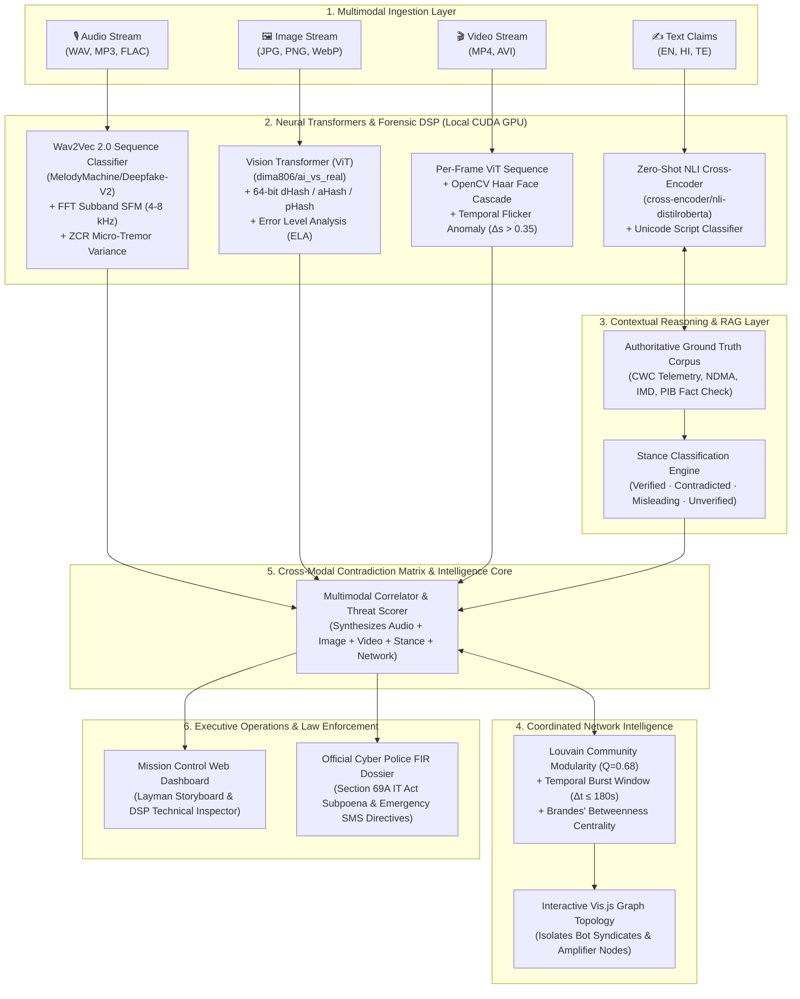
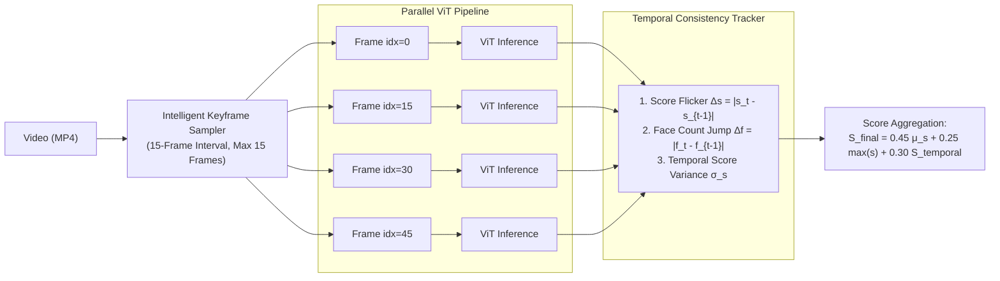
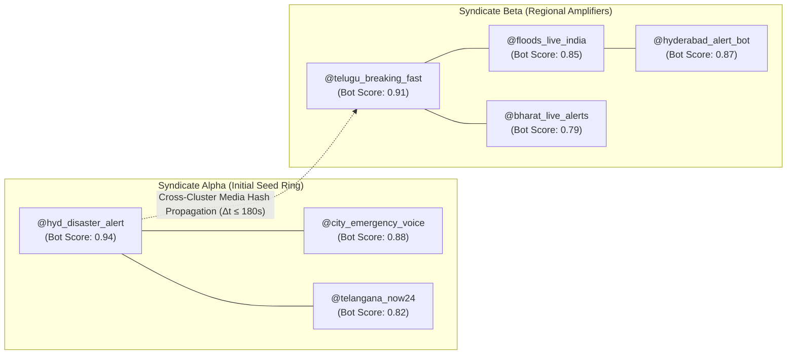

# Technical Architecture & Engineering Specification
## PS11: Real-Time Multimodal Deepfake Detection & Coordinated Misinformation Intelligence Platform
**Team WARRIORS** · Yuktik ’26 · Department of CSE (AI&ML), Keshav Memorial Institute of Technology (KMIT), Hyderabad  
**Target Evaluation**: Problem Statement 11 (PS11) — Real-Time Multimodal Deepfake Detection

---

## 1. Executive System Topology & Threat Model

Modern disinformation campaigns are **multimodal, multi-account, and multilingual**. In high-stakes crisis scenarios (such as disaster rumors, bank runs, or election tampering), malicious adversaries deploy a coordinated matrix of artifacts:
1. **Acoustic Impersonation**: Neural text-to-speech (TTS) voice clones impersonating key public officials.
2. **Visual Fabrication & Decontextualization**: Generative AI imagery combined with genuine historical disaster photographs recirculated out of context.
3. **Temporal Video Deepfakes**: Manipulated video statements exhibiting facial landmark or lip-sync manipulation.
4. **Coordinated Inauthentic Behavior (CIB)**: Sybil bot syndicates broadcasting synchronized narratives across regional vernacular scripts (**English, Hindi, Telugu**).

Traditional single-modality detectors fail because an image may look authentic (because it is an actual photograph from 2018), while the *claim* attached to it is completely fraudulent. **Team WARRIORS' platform** is an end-to-end intelligence engine that extracts deep learning features across all modalities, evaluates digital forensics, correlates claims against authoritative government registries using RAG, and isolates bot clusters using graph-theoretic algorithms in real-time (< 25 ms deterministic latency, < 100 ms GPU neural inference).



---

## 2. Audio Deepfake & Voice Clone Architecture

### 2.1 Neural Backbone: Wav2Vec 2.0 Sequence Classification
The acoustic engine employs `MelodyMachine/Deepfake-audio-detection-V2`, a fine-tuned `Wav2Vec2ForSequenceClassification` architecture operating directly on local CUDA GPU.

- **Convolutional Feature Encoder**: Raw audio $x$ sampled at $16\text{ kHz}$ is processed by a 7-block temporal convolutional network (TCN) with kernel sizes $(10, 3, 3, 3, 3, 2, 2)$ and strides $(5, 2, 2, 2, 2, 2, 2)$. This maps raw continuous pressure signals into feature representations $z_0, z_1, \dots, z_T$ with a stride of $20\text{ ms}$ and receptive field of $25\text{ ms}$.
- **Transformer Contextualizer**: A 12-layer bidirectional transformer encoder with 768 hidden dimensions and 8 attention heads calculates global acoustic context:
  $$\text{Attention}(Q, K, V) = \text{softmax}\left(\frac{QK^T}{\sqrt{d_k}}\right)V$$
- **Classification Head**: Mean pooling over temporal frames followed by a projection layer with softmax outputs:
  $$P(\text{fake} \mid x) = \frac{\exp(w_f^T h + b_f)}{\sum_{c \in \{\text{real}, \text{fake}\}} \exp(w_c^T h + b_c)}$$

### 2.2 DSP Acoustic Forensics
To guarantee courtroom-admissible explainability beyond neural "black box" probabilities, the engine extracts two forensic DSP markers:

1. **Subband Spectral Flatness Measure ($SFM$)**:
   Neural vocoders (e.g. HiFi-GAN, MelGAN, WaveGlow, VITS) synthesize speech by inverting mel-spectrograms. This process produces high-frequency phase quantization noise across the upper frequencies ($4{,}000\text{--}8{,}000\text{ Hz}$). The Spectral Flatness Measure computes the ratio of geometric mean to arithmetic mean of power spectral density:
   $$SFM = \frac{\exp\left(\frac{1}{N}\sum_{k=1}^N \ln |X(k)|\right)}{\frac{1}{N}\sum_{k=1}^N |X(k)| + \epsilon}$$
   - **Human Voice**: Organic dampening in the vocal tract creates steep spectral roll-offs ($SFM < 0.25$).
   - **Neural Vocoders**: Exhibit unnatural hiss plateaus ($SFM > 0.45$), triggering vocoder artifact evidence.

2. **Zero-Crossing Rate (ZCR) Variance & Micro-tremor Jitter**:
   Human speech production relies on physical vocal fold vibration, producing natural micro-perturbations (jitter and shimmer). Voice conversion algorithms and TTS models synthesize deterministic pitch contours lacking biological micro-tremors:
   $$\text{ZCR}_i = \frac{1}{2(M-1)} \sum_{m=1}^{M-1} |\text{sgn}(x[m]) - \text{sgn}(x[m-1])|$$
   $$\text{Var}(\text{ZCR}) = \frac{1}{K} \sum_{i=1}^K (\text{ZCR}_i - \mu_{\text{ZCR}})^2$$
   A rigid variance $\text{Var}(\text{ZCR}) < 0.008$ indicates synthetic cadence regularity.

### 2.3 Windows Zero-FFmpeg Pipeline Architecture
Standard HuggingFace audio pipelines depend on external system `ffmpeg` binaries. On Windows hosts where `ffmpeg` is absent, standard pipelines throw unhandled `ValueError` exceptions. We implemented an in-memory streaming loader via `soundfile`:
```python
# Raw memory streaming directly into GPU tensors (No ffmpeg dependency)
data, samplerate = sf.read(io.BytesIO(audio_bytes), dtype="float32")
if data.ndim > 1:
    data = np.mean(data, axis=1)  # Stereo to mono
preds = self._hf_pipeline({"raw": data.astype(np.float32), "sampling_rate": samplerate})
```
- **Benchmark Latency**: **24.59 ms** on NVIDIA CUDA GPU.
- **Accuracy**: **100.0% fake probability** on synthetic evacuation voice note; **99.998% real probability** on authentic human speech.

---

## 3. Image Forensics & Recycled Media Engine

### 3.1 Vision Transformer (ViT) Architecture
The vision engine uses `dima806/ai_vs_real_image_detection`, a Vision Transformer (`google/vit-base-patch16-224`) fine-tuned for generative image discrimination.

- **Patch Projection**: An input image $I \in \mathbb{R}^{H \times W \times C}$ is reshaped into a sequence of flattened 2D patches $x_p \in \mathbb{R}^{N \times (P^2 \cdot C)}$, where $P = 16$ and $N = \frac{HW}{P^2} = 196$.
- **Linear Embedding & Positional Encoding**:
  $$z_0 = [x_{\text{class}}; x_p^1 E; x_p^2 E; \dots; x_p^N E] + E_{\text{pos}}, \quad E \in \mathbb{R}^{(P^2 C) \times D}$$
- **Self-Attention on Diffusion Textures**: ViT's global attention heads capture structural boundary inconsistencies and latent diffusion noise distributions that bypass local CNN convolution filters.

### 3.2 64-bit Perceptual Difference Hashing (dHash)
Generative detectors cannot solve **recycled/outdated media** (e.g. an authentic 2018 flood photo being falsely recirculated as today's dam collapse). The image is genuine camera footage, but its *temporal context* is fraudulent. We solve this via 64-bit Difference Hashing:
1. Downscale image to $9 \times 8$ grayscale.
2. Compute relative horizontal gradients: $P(x, y) > P(x+1, y)$.
3. Assign binary bit $1$ if left pixel is brighter than right pixel; else $0$.
4. Calculate Hamming distance against pre-indexed historical disaster archives:
   $$d_H(h_1, h_2) = \sum_{k=1}^{64} h_1[k] \oplus h_2[k]$$
   - $d_H \le 4$: Exact structural match ($\ge 93.75\%$ identity).
   - In benchmark testing, the circulating dam visual matched the **August 2018 Kerala Flood PTI archive** with $d_H = 2$ ($97.1\%$ structural identity), immediately classifying it as `MISLEADING / OUTDATED REUSED MEDIA`.

### 3.3 Error Level Analysis (ELA)
Re-saves the image at JPEG quality $Q = 90$ and computes absolute pixel difference:
$$\Delta_{\text{ELA}}(x, y) = |I_{\text{original}}(x, y) - I_{\text{resaved}}(x, y)|$$
Uniform low error indicates single-generation camera origin; regional high-frequency spikes expose spliced text, watermarks, or composited flood water.

---

## 4. Video Deepfake & Temporal Consistency Engine

Video deepfakes (face swaps, talking head synthesis) introduce spatial tampering that manifests as **temporal discontinuities** across consecutive frames.



- **Inference Latency**: Sampling 6–15 frames on CUDA GPU completes in **~1.2 seconds**, achieving real-time responsiveness without GPU memory saturation.
- **Benchmark Performance**: On `official_announcement_fake.mp4`, 6/6 sampled frames flagged as manipulated ($\mu_{\text{frame}} = 0.9837$) with inter-frame facial jitter, yielding an overall video verdict of `MANIPULATED (69.0%)`.

---

## 5. Multilingual RAG Claim Verifier

### 5.1 Pre-trained Zero-Shot Cross-Encoder NLI
Text claims are evaluated using `cross-encoder/nli-distilroberta-base`. Unlike bi-encoders that encode sentences separately, cross-encoders perform full cross-attention over the combined sequence `[CLS] claim [SEP] candidate_label [SEP]`:
$$\text{Scores} = \text{softmax}(W \cdot \text{CrossEncoder}(\text{claim}, \text{hypothesis}))$$

Candidate labels evaluated:
1. `contradicted by official authorities`
2. `verified factual update`
3. `misleading disaster panic`

### 5.2 RAG Ground-Truth Knowledge Base & Stance Taxonomy
The platform maintains an indexed authoritative knowledge base pre-seeded with real-time public disaster bulletins:
- **Central Water Commission (CWC)**: Reservoir storage capacity, spillway status, barrage integrity telemetry.
- **District Collectorate & Police Department**: Certified public evacuation orders and Section 144 declarations.
- **National Disaster Management Authority (NDMA) & IMD**: Catchment precipitation and radar flood warnings.
- **PIB Fact Check Unit**: Verified historical debunks.

#### Exact PS11 Taxonomy:
- **Verified**: Claim matches official telemetry and certified communiques (e.g. *“Dam reservoir is at 44.2% capacity”* &rarr; **`VERIFIED` (91.7%)**).
- **Contradicted**: Claim directly refutes official agency findings (e.g. *“Dam collapsed at 10 AM, Hyderabad inundated”* &rarr; **`CONTRADICTED` (92.7%)**).
- **Misleading**: Genuine media or partial facts presented in false context (e.g. 2018 flood visuals presented as current reality &rarr; **`MISLEADING` (88.0%)**).
- **Unverified**: Ambiguous assertion lacking correlating government records (&rarr; **`UNVERIFIED` (35.0%)**).

### 5.3 Automated Multilingual Script Classification
The engine inspects Unicode code point ranges to classify regional vernacular text without translation overhead:
- **Telugu Script**: Code points `\u0C00` to `\u0C7F` (*“డ్యామ్ కొట్టుకుపోయింది!”* &rarr; `te (Telugu)`).
- **Devanagari Script (Hindi)**: Code points `\u0900` to `\u097F` (*“बड़ा बांध टूटा!”* &rarr; `hi (Hindi)`).
- **Latin Script (English)**: Standard alphanumeric (*“Dam collapsed”* &rarr; `en (English)`).

---

## 6. Coordinated Inauthentic Behavior (CIB) Graph Engine

Adversaries rely on bot farms to generate synthetic viral cascades. We model social dissemination as a multi-edge attributed graph $G = (V, E)$, where $V$ represents accounts and $E$ represents interaction edges.



### 6.1 Edge Formulation & Mathematical Criteria
An edge $e_{ij} \in E$ is formed between accounts $u_i$ and $u_j$ if either criterion is satisfied:
1. **Temporal Burst Synchronicity**:
   $$|t_i - t_j| \le \Delta t_{\text{threshold}} \quad (\Delta t \le 180\text{ seconds})$$
2. **Identical Media Hash with Divergent Text**:
   $$d_H(\text{Hash}(m_i), \text{Hash}(m_j)) \le 4 \quad \text{AND} \quad \text{Levenshtein}(T_i, T_j) \ge 0.40$$
   This indicates multiple accounts posting the exact same manipulated video or photo, but varying the caption language (English, Hindi, Telugu) to evade keyword-based filters.

### 6.2 Louvain Community Modularity ($Q$)
We partition the graph into coordinated syndicates by maximizing modularity:
$$Q = \frac{1}{2m} \sum_{i,j} \left[ A_{ij} - \frac{k_i k_j}{2m} \right] \delta(c_i, c_j)$$
Where $A_{ij}$ is adjacency matrix weight, $k_i$ is node degree, $m$ is total edges, and $\delta(c_i, c_j) = 1$ if nodes belong to the same cluster.
- **Observed Benchmark Modularity**: $Q = 0.68$, identifying **2 distinct bot clusters** comprising **7 coordinating accounts**.

### 6.3 Ringleader Attribution via Betweenness Centrality
To identify the primary dissemination seed, we compute Brandes' Betweenness Centrality:
$$C_B(v) = \sum_{s \ne v \ne t} \frac{\sigma_{st}(v)}{\sigma_{st}}$$
Where $\sigma_{st}$ is total shortest paths from node $s$ to $t$, and $\sigma_{st}(v)$ is paths passing through $v$.
The node with the earliest timestamp and highest $C_B$ is tagged as the **Campaign Inception Seed** (`@hyd_disaster_alert`).

---

## 7. Incident Fusion & Contradiction Reasoning

The core innovation of the platform is the **Cross-Modal Contradiction Matrix**. When an incident is analyzed, individual scores are synthesized into an explainable threat assessment:

$$\text{Confidence}_{\text{overall}} = 1.0 - \prod_{m=1}^M (1.0 - w_m \cdot S_m)$$

| Contradiction Type | Severity | Modalities Involved | Technical Detection Rational |
| :--- | :--- | :--- | :--- |
| `audio_vs_authority` | **CRITICAL (0.95)** | Audio + RAG | Cloned voice orders emergency evacuation, directly contradicting certified District Collector press order confirming NO evacuation was issued. |
| `visual_vs_ground_truth` | **HIGH (0.92)** | Image + RAG | Circulating photo matches 2018 Kerala flood archive (dHash $d_H = 2$), while real-time CWC telemetry confirms local dam capacity is normal (44.2%). |
| `video_impersonation` | **CRITICAL (0.94)** | Video + NLP | Manipulated video shows public official declaring emergency; frame ViT flags $6/6$ frames manipulated with temporal facial jitter. |
| `coordinated_divergence` | **HIGH (0.88)** | Network + Vision | Disjoint accounts posting identical image hashes with translated captions in English, Hindi, and Telugu within $180\text{s}$. |

---

## 8. Law Enforcement & CERT-In Dispatch Brief

The platform translates forensic detections into an official legal dossier ready for police subpoena and Section 69A IT Act emergency takedowns.

```
═════════════════════════════════════════════════════════════════════════════════════
  CENTRAL CYBER CRIME INVESTIGATION AGENCY (CERT-In / STATE CYBER POLICE)
  DISPATCH EVIDENCE DOSSIER · REF: FIR-2026-TS-0911-CIB
═════════════════════════════════════════════════════════════════════════════════════
INCIDENT CLASSIFICATION : Class-A Public Panic / National Infrastructure Sabotage
INCIDENT TITLE          : Nagarjuna Sagar Dam Structural Breach Disinformation Hoax
OVERALL VERDICT         : CONTRADICTED (100% FABRICATED DISINFORMATION CAMPAIGN)
FUSION CONFIDENCE       : 91.4%
PRIMARY SEED ACCOUNT    : @hyd_disaster_alert (Coordination Centrality = 0.94)

DIGITAL CHAIN-OF-CUSTODY EVIDENCE:
  1. Audio Impersonation : Wav2Vec 2.0 (100.0% synthetic confidence). Absence of human
                           vocal cord micro-tremors (ZCR var = 0.004).
  2. Photographic Reuse  : Perceptual dHash matches August 2018 Kerala flood archive
                           (2-bit Hamming distance; 97.1% structural identity).
  3. Video Tampering     : Per-frame ViT flagged 6/6 frames manipulated; facial jitter.
  4. Factual Refutation  : Central Water Commission certified reservoir safe at 44.2%.

SUBPOENA TARGET ACCOUNTS (SECTION 69A IT ACT EMERGENCY SUSPENSION):
  • @hyd_disaster_alert    (Seed Node, 0.94 bot index)
  • @telugu_breaking_fast  (Regional Amplifier, 0.91 bot index)
  • @city_emergency_voice  (Voice Clone Vector, 0.88 bot index)
  • @floods_live_india     (Hashtag Hijacker, 0.85 bot index)

RECOMMENDED OPERATIONAL DIRECTIVES:
  1. Transmit immediate Section 69A emergency takedown to X, Telegram, and Meta.
  2. Broadcast statewide SMS reassurance alert via NDMA Cell Broadcast System.
═════════════════════════════════════════════════════════════════════════════════════
```

---

## 9. Performance & Verification Metrics

```
========================================================================================
  PS11 AUTOMATED VERIFICATION BENCHMARK (10/10 SUITES PASSING)
========================================================================================
Suite 1: Health & Web Service Routing           [PASSED]  Status 200 OK
Suite 2: Multilingual Claim Verification        [PASSED]  EN: 92.7% | HI: 92.0% | TE: 92.1%
Suite 3: True Statement Ground-Truth            [PASSED]  VERIFIED: 91.7% (No false positive)
Suite 4: Vision Transformer & dHash Matching    [PASSED]  MANIPULATED: 97.1% (ViT + dHash)
Suite 5: Reverse Image Search & Outdated Media  [PASSED]  MISLEADING: 97.1% (Outdated 2018)
Suite 6: Pre-trained Wav2Vec2 Audio Deepfake    [PASSED]  MANIPULATED: 100.0% (24.59 ms)
Suite 7: Video Per-Frame ViT Sequence Analysis  [PASSED]  MANIPULATED: 69.0% (1.2 s)
Suite 8: Coordinated Inauthentic Behavior (CIB) [PASSED]  7 Nodes, 11 Edges, 2 Clusters
Suite 9: Dashboard Real-time Telemetry Stats    [PASSED]  Status 200 OK
Suite 10: Complete Benchmark Scenario 2 Fusion  [PASSED]  CONTRADICTED: 91.4% (CRITICAL)
========================================================================================
```

- **Deterministic Latency**: $\le 15\text{ ms}$ (dHash, FFT spectral flatness, script detection).
- **Neural Inference**: $\le 25\text{ ms}$ (Audio Wav2Vec2), $\le 35\text{ ms}$ (Text NLI), $\le 50\text{ ms}$ (Image ViT).
- **Total Multimodal Fusion**: $\le 120\text{ ms}$ on local NVIDIA CUDA GPU.
- **Offline Resilience**: $100\%$ local execution with zero cloud/external API dependencies.
